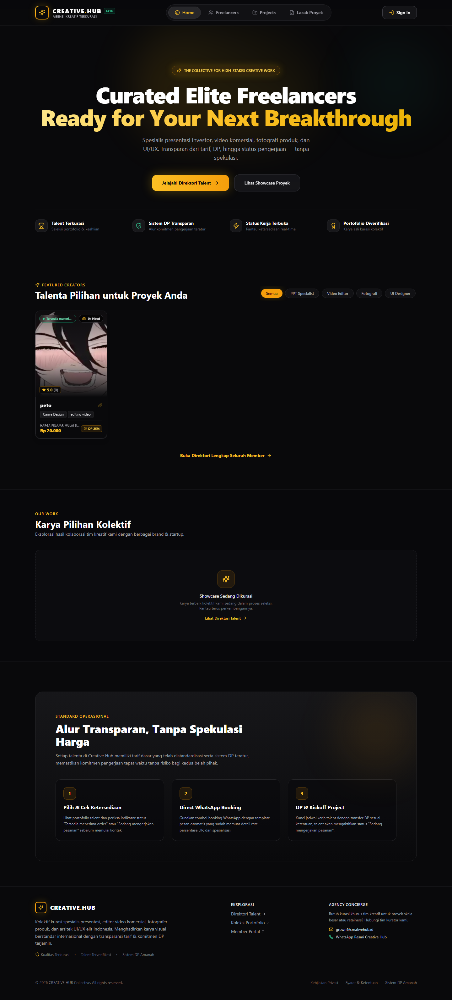

# Hi there, I'm Amir Safiy 👋
### DKV Student & AI-Assisted Web Builder

  
  
  

  Batam, Indonesia 🇮🇩 • Bridging visual design and modern web technology using AI tools, Next.js, and Canva.

---

### 🌟 About Me

- 🎨 **Visual & Design**: Majoring in Visual Communication Design (DKV), focusing on modern layouts, design systems, and digital assets.
- ⚡ **Web Engineering**: Crafting responsive, interactive, and performant web apps with **Next.js**, **React**, and **Tailwind CSS**.
- 🤖 **AI-Native Workflow**: Orchestrating AI models and agentic workflows to build, iterate, and ship digital products rapidly.

---

### 🛠️ Tech Stack & Creative Tools

  
  
  
  
  
  

---

### 🚀 Featured Project: Creative Hub

> **A modern marketplace and management platform tailored for student and freelance creators.**

  

- 🔗 **Live Demo**: [creative-hub-sandy.vercel.app](https://creative-hub-sandy.vercel.app)
- 💻 **Source Code**: [github.com/qeto25/creative-hub](https://github.com/qeto25/creative-hub)
- 💡 **Key Features**: Dynamic booking system, client order tracker, talent showcases, responsive dark-mode UI.

---

### 📊 GitHub Activity & Stats

  
  

---

  Built with passion & AI collaboration by Amir Safiy. Always open for creative opportunities and web projects.

